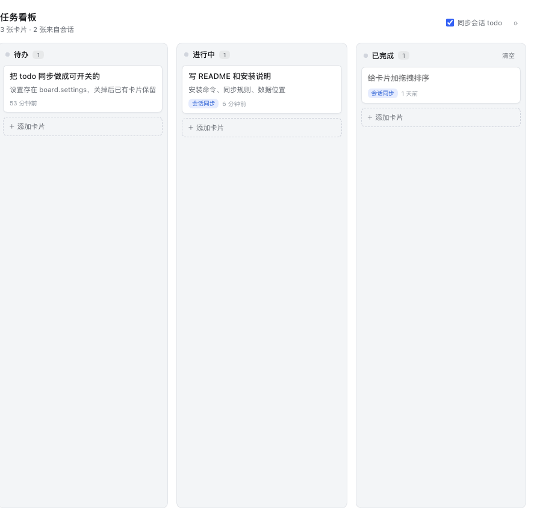

<div align="center">

# dsh-kanban

**给 DeepSeek Harness 加一块任务看板：列、卡片、拖拽，和会话里的 todo 自动打通，agent 也能自己上板。**




</div>

## 是什么

截图来自真实 DSH 桌面端：左侧栏「任务看板」→ 主区域。

一个 DSH 插件（host + client 两半）：

- **左侧栏一个「任务看板」入口**，点开在主区域铺满三列：待办 / 进行中 / 已完成
- **卡片**支持新建、双击改标题、拖拽换列和排序、两步删除、归档
- **卡片可以带提示词**：点「执行」就在一个新会话里把这段提示词发出去，agent 直接开干，卡片自动进「进行中」并留下会话链接
- **和会话打通**：agent 每次写 `todo_write`，插件会把 todo 同步成卡片，状态跟着走
- **agent 可读写**：6 个 `kanban_*` 工具，agent 能自己建卡、移卡、改卡、删卡
- **落盘**：数据存在 `$DSH_HOME/integrations/dsh-kanban/board.json`，换窗口、重开会话都不丢

## 安装

插件装进某个 profile（桌面端就是 `desktop`）。

### 用 GitHub 地址

```bash
dsh plugin --profile desktop add github:dcchanInSz/dsh-kanban
```

或者打开 DSH 侧边栏的 **插件** 页面，在安装框里填 `github:dcchanInSz/dsh-kanban`。

### 本地开发（改了立刻生效）

```bash
git clone https://github.com/dcchanInSz/dsh-kanban.git
cd dsh-kanban && npm install && npm run build

dsh plugin --profile desktop add link:"$PWD"
```

`link:` 会建软链接，改完 `lib/client.js` / `lib/index.js` 重启插件即可，不必重装。

### 卸载

```bash
dsh plugin --profile desktop remove dsh-kanban
```

看板数据不会被删；想一起清掉就删 `~/.dsh/integrations/dsh-kanban/`。

## 使用

| 操作 | 说明 |
| --- | --- |
| 点左侧栏「任务看板」 | 打开主区域看板 |
| 每列底部「＋ 添加卡片」 | 第一行是标题，换行后是备注；⌘↩ 提交、Esc 取消 |
| 拖动卡片 | 换列 / 在同列里排序，松手即保存 |
| 双击卡片标题 | 就地改名，回车保存 |
| 卡片右下「×」 | 点两次删除（防误触） |
| 已完成列右上「清空」 | 一次清掉所有已完成卡片 |
| 卡片上 ✨ 的那行 | 点一下就地编辑提示词；没有提示词的卡片 hover 时出现「＋提示词」 |
| 卡片上「▶ 执行」 | 新建一个会话，把提示词原文发进去跑起来，卡片自动移到「进行中」 |
| 卡片上「打开会话」 | 跳回上次执行这个任务的会话（列表里也有） |
| 右上「同步会话 todo」 | 关掉后 agent 的 todo 不再自动建卡 |

#### 关于「同步会话 todo」

规则是刻意做得可预测的：

1. agent 调用 `todo_write` 后，未完成的 todo 建卡进「待办 / 进行中」，已完成的进「已完成」
2. 同一条 todo（按内容哈希 + 会话 id 识别）只会有一张卡，标题跟着 todo 内容更新
3. **你手动拖动过一张同步来的卡片后，它的列就归你了**——后续 todo 状态变化不会再把它挪回去
4. **删掉的同步卡片不会被重建**（记了墓碑）
5. 关掉开关后，已有的卡保留，新的 todo 不再同步

卡片右上角会标 `会话同步`（来自 todo）或 `agent`（工具创建），自己建的不带标。

## 提示词与执行

一张卡片可以带一条提示词。点「▶ 执行」时插件会：

1. `session/create` 新建一个会话（用当前工作区；没有就用默认目录）
2. `session/prompt` 把提示词原文作为用户消息发进去
3. 给卡片记下 `lastRun.sessionId`，把它移到「进行中」，并跳到那个会话

所以每个任务都是在干净的上下文里跑的，不会污染你正在看的对话；卡片上留「打开会话」，随时能回去看它干到哪了。

发给 agent 的只有**提示词原文**，标题和备注只给人看。执行过的卡片会被标记，之后 todo 同步不会再把它的列改掉。

## 给 agent 的工具

| 工具 | 作用 |
| --- | --- |
| `kanban_list` | 按列列出所有卡片，附卡片 id |
| `kanban_add` | 新建卡片（`title` 必填，可带 `note` / `prompt` / `column`）|
| `kanban_move` | 移动卡片到指定列 |
| `kanban_update` | 改标题 / 备注 / 提示词 |
| `kanban_delete` | 删除卡片 |
| `kanban_sync_todos` | 立刻把当前会话的 todo 同步一次 |

对着 agent 说「把这 5 件事排进看板」它就会用 `kanban_add` 建卡；说「第一件做完了」它会 `kanban_move`。

## 数据

`$DSH_HOME/integrations/dsh-kanban/board.json`（默认 `~/.dsh/integrations/dsh-kanban/board.json`）：

```json
{
  "version": 1,
  "revision": 12,
  "columns": [
    { "id": "backlog", "title": "待办" },
    { "id": "doing", "title": "进行中" },
    { "id": "done", "title": "已完成" }
  ],
  "cards": [
    {
      "id": "c_1a2b3c4d",
      "title": "写 README",
      "note": "包含安装说明",
      "column": "doing",
      "createdAt": 1761400000000,
      "updatedAt": 1761400500000,
      "source": { "kind": "todo", "sessionId": "s_abc", "key": "9f2c1e7d3a4b" },
      "todoStatus": "in_progress",
      "prompt": "把 README 的安装章节重写，中文为主",
      "lastRun": { "sessionId": "session-9f2c", "at": 1761400700000 },
      "pinned": true
    }
  ],
  "deleted": [{ "sessionId": "s_abc", "key": "aabbccdd", "at": 1761400600000 }],
  "settings": { "autoSyncTodos": true }
}
```

写入是串行的「读-改-写 + 临时文件 + rename」，不会出现半截文件。

## 结构

```
lib/index.js         宿主端：board.json 读写、/api/dsh-kanban RPC、kanban_* 工具、todo 同步
lib/client.js        客户端：入口 + 面板（构建产物）
src/client/          面板源码（React + JSX）
  board.jsx            三列看板、拖拽、就地编辑
  index.jsx            注册 main / sidebar.panellist 槽位
  styles.js            样式与主题跟随
  rpc.js               /api 调用封装
  runner.js            「执行」：session/create + session/prompt + 跳转
scripts/build-client.mjs   esbuild 打包（React 走宿主的，不重复打包）
test/host.test.mjs    node:test：存储、RPC、工具、同步语义
dev/harness.html      免安装预览面板
docs/                 截图
```

## 开发

```bash
npm install
npm run build      # 产出 lib/client.js
npm test           # 11 项宿主测试
npm run build -- --with-harness   # 额外产出 dev/harness.js
open dev/harness.html              # 浏览器里直接调 UI
```

面板是纯 React，不依赖 DSH 内部的组件库；样式用 CSS 变量，按宿主 `color-scheme` 自动切亮/暗。

## 兼容性

- 宿主版本：DSH `0.2.0-rc.2`（desktop / web profile）
- 依赖的公开面：`slots`（`main`、`sidebar.panellist`）、`connection.fetch.register`、`connection.rpc.call`、`tools.register`、`session/event`
- 不 import 任何 `@deepseek-ai/*` 包：profile 插件只解析自己的 node_modules，硬依赖 DSH 内部包会装出第二份实例

## 许可

[MIT](LICENSE) © 2026 dcchanInSz
